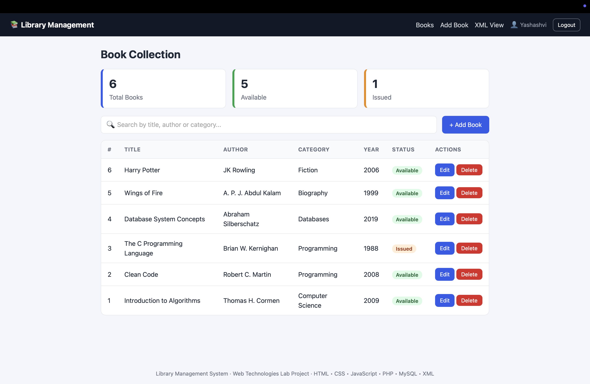
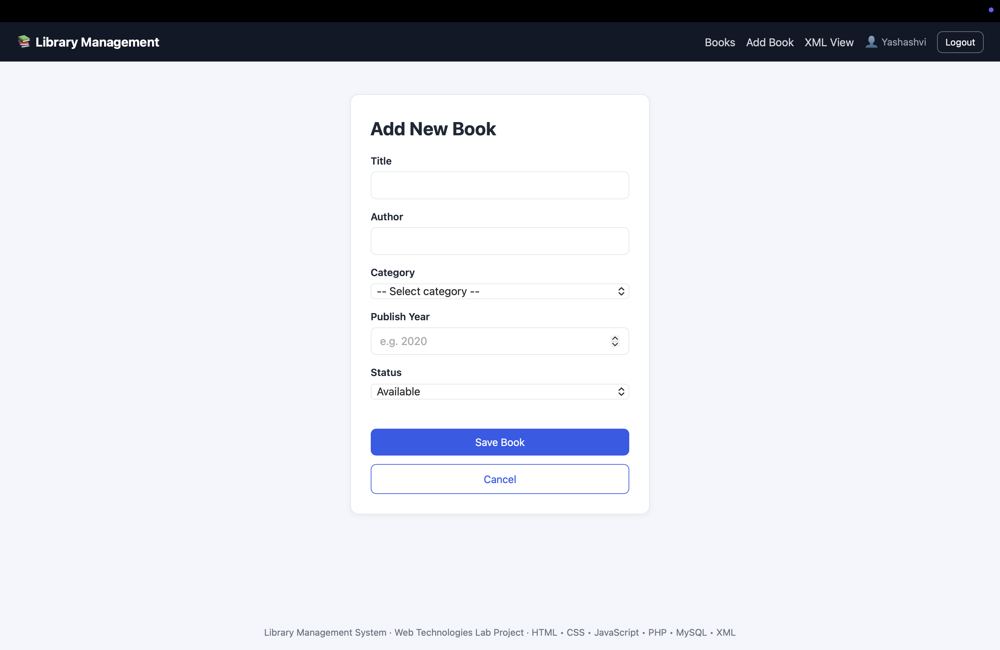
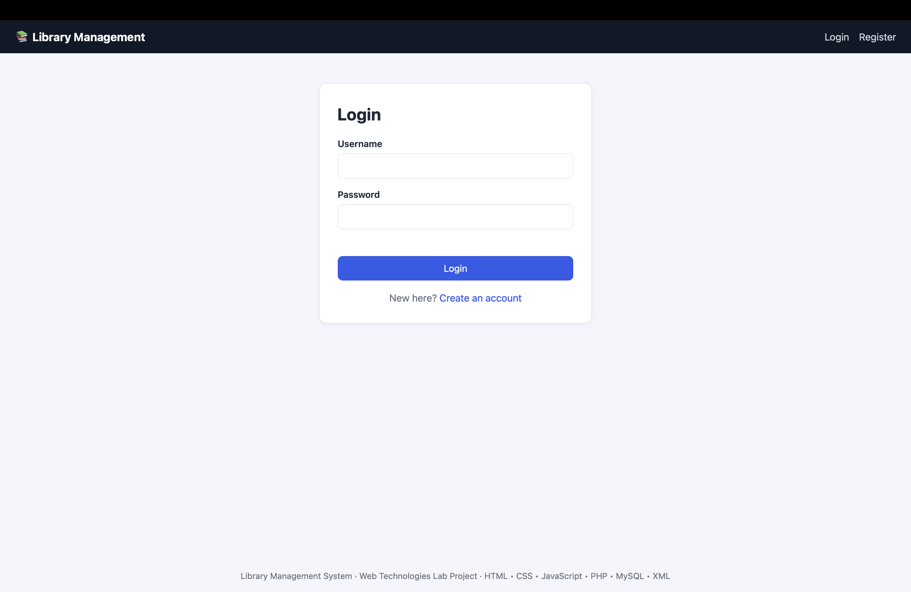
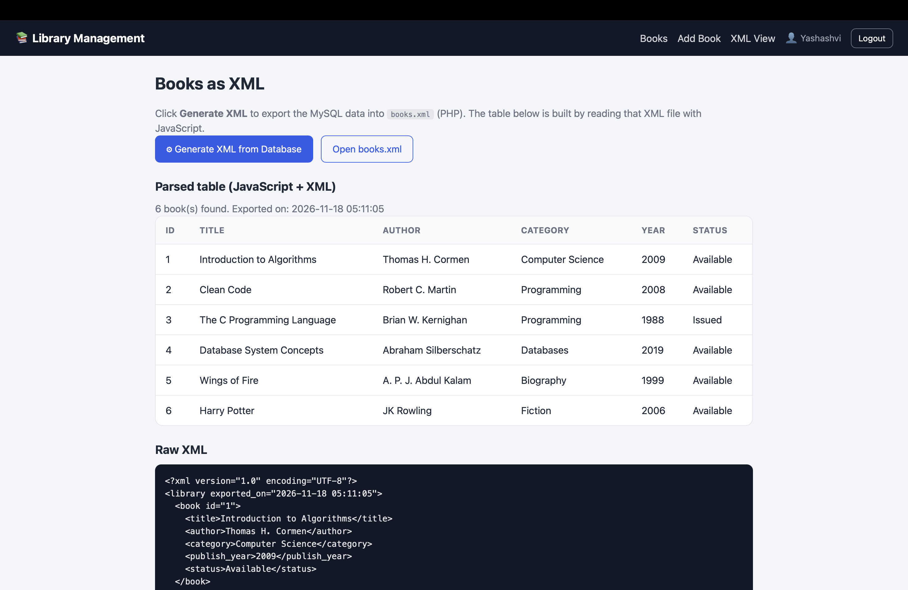

# Library Management System

A small full-stack web app for managing a book collection. Users can register, log in, and **add, view, edit, delete and search** books. Book data can also be exported to **XML** and read back in the browser with JavaScript.

> **About this project:** built as a Web Technologies lab project (B.E. CSE, 3rd semester) while learning PHP and MySQL, with AI assistance. I went through the code to understand the full request flow: forms, sessions, prepared statements, and XML parsing.

## Screenshots

| Dashboard                               | Add Book                              |
| --------------------------------------- | ------------------------------------- |
|  |  |

| Login                           | XML View                              |
| ------------------------------- | ------------------------------------- |
|  |  |

## Features

- User registration and login (passwords hashed with `password_hash`)
- Session-based authentication, so only logged-in users see the books
- Full CRUD: add, view, edit and delete books
- Live search by title, author or category (JavaScript)
- Dashboard stats: total, available and issued books
- Client-side (JS) and server-side (PHP) form validation
- Export books to `books.xml` and view it using `fetch()` + `DOMParser`
- Responsive layout

## Tech stack

| Technology | Used for                                                                               |
| ---------- | -------------------------------------------------------------------------------------- |
| HTML       | Structure of every page (forms, tables, navbar)                                        |
| CSS        | `css/style.css`: layout, colours, responsive design                                    |
| JavaScript | `js/script.js`: validation, live search, delete confirm. `js/xml_viewer.js`: reads XML |
| PHP        | Login/sessions, CRUD logic, MySQL queries, XML generation                              |
| MySQL      | `users` and `books` tables (`database.sql`)                                            |
| XML        | `books.xml` generated by `export_xml.php`, parsed by `xml_viewer.js`                   |

## Security basics used

- **Prepared statements** (`prepare`, `bind_param`, `execute`) to prevent SQL injection
- **`password_hash()` / `password_verify()`** so real passwords are never stored
- **`htmlspecialchars()`** (via the `e()` helper) on all output to prevent XSS
- Database credentials kept in a separate `config.php` that is not committed

## How to run it locally

1. Install **XAMPP** (or **MAMP** on Mac) and start **Apache** and **MySQL**.
2. Copy this folder into the server's web folder as `library-system`:
   - XAMPP: `htdocs/` (Mac: `/Applications/XAMPP/xamppfiles/htdocs/`)
   - MAMP: `htdocs/`
3. Open **phpMyAdmin** (`http://localhost/phpmyadmin`), click **Import**, choose `database.sql`, click **Go**. This creates the `library_db` database with both tables and sample books.
4. Create your config file:
   - Copy `includes/config.example.php` to `includes/config.php`
   - XAMPP: leave the defaults (password empty, port 3306)
   - MAMP: set the password to `"root"` and the port to `8889`
5. Open `http://localhost/library-system/` (MAMP: `http://localhost:8888/library-system/`).
6. Click **Register**, create an account, then **Login**.

## Project structure

```
library-system/
├── database.sql        MySQL tables + sample data
├── index.php           redirects to login or dashboard
├── register.php        create account (validation + INSERT + password_hash)
├── login.php           log in (SELECT + password_verify + session)
├── logout.php          end session
├── dashboard.php       list books + stats + search box     (READ)
├── add_book.php        add a book                          (CREATE)
├── edit_book.php       change a book                       (UPDATE)
├── delete_book.php     remove a book                       (DELETE)
├── export_xml.php      MySQL -> books.xml (PHP DOMDocument)
├── view_xml.php        page that shows books.xml
├── includes/
│   ├── db.php              MySQL connection ($conn)
│   ├── config.example.php  template for DB settings
│   ├── auth.php            session, require_login(), e() escape, flash messages
│   ├── header.php          top of every page (HTML head + navbar)
│   └── footer.php          bottom of every page
├── css/style.css
├── js/
│   ├── script.js       form validation, live search, delete confirm
│   └── xml_viewer.js   fetch() + DOMParser to read books.xml
└── screenshots/        images used in this README
```

## How a request flows

1. Browser asks for `dashboard.php`.
2. Apache runs the PHP. `require_login()` checks `$_SESSION`.
3. PHP runs `SELECT ... FROM books` through `$conn` (MySQL).
4. PHP prints HTML (rows inside a table) and sends it to the browser.
5. CSS styles it, and JavaScript makes the search box filter rows.

## Possible improvements

- Add an ISBN column and cover images
- Track which member borrowed a book, with due dates
- Pagination for large collections
- Rebuild the backend in Python (Flask/Django) and compare the two stacks

## Author

Yashashvi, B.E. CSE student.
